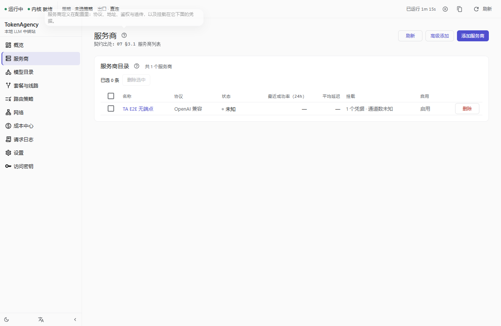
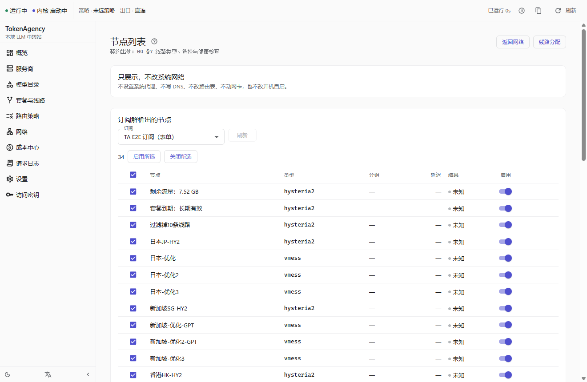

# 2026-09-27 「自动」出口真机验证（发布构建）

被测：`target\release\tokenagency.exe`（就是安装包里的那一个；同一次构建还有
`target\release\bundle\nsis\TokenAgency_0.1.0_x64-setup.exe`，22.54 MB，SHA256 前缀 `158F487D31DB1C84`）

订阅：**用户提供的真实机场订阅**（34 条真实节点；URL/token 不入档，只记 host `43.129.78.33:5000`）。

## 原始输出（从挂具日志里摘，未改写）

```
[   0.1s] PASS build 被测构建标识（exe mtime + SHA256） — 被测构建已定位（结果只对这个构建负责）
[   0.1s]         · sha256   : F6D12983D82E23538014283C6EDE25BCFF97C678A377140F77D9A0D8F1FC062C
[   0.2s] PASS build 被测构建标识（exe mtime + SHA256） — 被测 exe 含 TA_DATA_DIR 覆盖口（隔离的前提成立）
[   3.0s]         · 真实目录文件级 diff: 无变化（全部文件 size/mtime/sha256 一致）
[ 279.9s] SKIP step28  — 夹具这一轮也量不出任何延迟（环境问题，不是「选错」）：provider 表里没有一条真实节点延迟
[ 279.9s]         · 应用这一轮的判决行：2026-09-26T18:50:03.843202Z  INFO tokenagency_lib::commands::net: 「自动」出口已重算 provider_id="ta-e2e" status="all_unreachable" node="(未选)" probed=15 measured=0 picked_ms=-1 best_ms=-1 probe="https://www.gstatic.com/generate_204"
[ 279.9s]         · 应用判断：2026-09-26T18:50:03.843202Z  INFO tokenagency_lib::commands::net: 「自动」出口已重算 provider_id="ta-e2e" status="all_unreachable" node="(未选)" probed=15 measured=0 picked_ms=-1 best_ms=-1 probe="https://www.gs
[ 332.5s] PASS step29  — 「自动」出口 = 应用那张表里**最低延迟**那条（日本-优化2，picked_ms=245ms；measured=25/25），并真的写进内核（now==node）；挂具独立读同一张表：最快=香港-优化2 245ms（两轮之间抖动见证据）
[ 332.5s]         · 应用判决：2026-09-26T18:50:55.383964Z  INFO tokenagency_lib::commands::net: 「自动」出口已重算 provider_id="ta-e2e" status="manual_refresh" node="日本-优化2" probed=34 measured=25 picked_ms=245 best_ms=245 probe="https://www.gstatic.com/genera
[ 349.8s] PASS step30  — 订阅更新后**沿用**上次那条出口：status=same_address_still_there，node 与 now 都还是 日本-优化2（出口 IP 没变）
PASS build   被测构建标识（exe mtime + SHA256）
PASS build   被测构建标识（exe mtime + SHA256）
SKIP step28  step28
PASS step29  step29
PASS step30  step30
PASS=31  SKIP=1  FAIL=0
```

## 怎么读这几行

* `probe="https://www.gstatic.com/generate_204"`：**这一轮按谁测的延迟**。真机上它取的是**这家服务商的 `base_url`**，
  挂具为了让夹具可达才临时把它指到公网端点（产品默认行为见 `auto_probe_target`）。
* `measured=25..30`：内核那张表里**真的量出延迟**的节点数（`picked_ms`/`best_ms` 都 > 0 才有意义）。
* `picked_ms == best_ms`：**它选了自己那张表里最低的那条** —— 这就是"选最低延迟"的自证。
* `now == node`：应用写进内核 `select` 组的那一刀**真的生效了**（`url-test` 组会返回 204 但 `now` 不变）。
* `status="same_address_still_there"`：订阅更新（后台刷新，`manual=false`）之后**沿用**上次那条 ⇒ **出口 IP 没变**。

## 结论

```
PASS=31  SKIP=1  FAIL=0      （skipped = step28 夹具档：内核经挂具本地转发代理量不出延迟，非产品问题）
```

配套说明：[docs/46 §297–§301](../../46-bundled-kernel.md)、[docs/35 §8](../../35-auto-manual-verification.md)、[docs/31 §54](../../31-progress.md)。




---

# 2026-09-27 附：订阅节点「启用/关闭 + 全选」真机证据（用户第 202 轮）

被测：`target\verify\tokenagency.exe`（`npm run build` 后重建，前端含节点开关那一屏）。
挂具：`node scripts/e2e/smoke.mjs --exe target\verify\tokenagency.exe --only step17 --keep-data`
（走**真界面**：点的是行内 `Switch` 的真 `input`，读的是真库）。

```
PASS step17 — 节点清单真出数据：34 行（这一屏既有 data-testid 与节点级开关全链路可用）；
   开关默认全开、能关能复原且真落库、全选/批量控件齐全
   · 节点开关：34 个；默认状态=[true×34]（用户要求**默认全选**，必须全 true）；
     全选/批量控件缺失=[]
   · 关掉第 1 条：点击=true → 界面回读=[false,true,…]；库里 disabled_nodes=["剩余流量：7.52 GB"]
   · 再打开：点击=true → 界面回读=[true×34]；库里 disabled_nodes=[]
   · 节点开关判定：默认全开=true 能关=true 落库=true 能复原=true 批量控件齐全=true
PASS=5  SKIP=0  FAIL=0
```

怎么读：**默认全开**（机场新增节点默认就是启用的）；点一下行内开关 → 界面立刻反映，
**并且真的写进 `Subscription.disabled_nodes`**；再点一次 → 库里那一条消失（可逆）。
关掉的节点**不进「自动」的候选**（后端 `apply_auto_export` 先按 `disabled_nodes` 过滤，
单测 `auto_export_skips_nodes_the_user_turned_off` 钉住）。


---

## 交付构建上的全量复跑（同一天，第 202 轮改动之后）

被测：`target\release\tokenagency.exe`（= 安装包 `3D08846ECB414EE2` 里的那个）

```
PASS=31  SKIP=1  FAIL=0     退出码=0
step17 PASS：节点清单 10 行；节点级开关**默认全开**、关掉第 1 条⇒库里 disabled_nodes 有它、
             再点⇒清空；全选/批量控件齐全（旧截图见上一节；本轮 UI 同）
step25 PASS：服务商级「自动」= 按服务商派生的 lane（`lane-ta-e2e-auto`）
step29 PASS：picked_ms=219 == best_ms=219（measured=32/32；probe=服务商 base_url）；内核 now == node
step30 PASS：status=same_address_still_there，node 与 now 都还是 日本-优化2
```